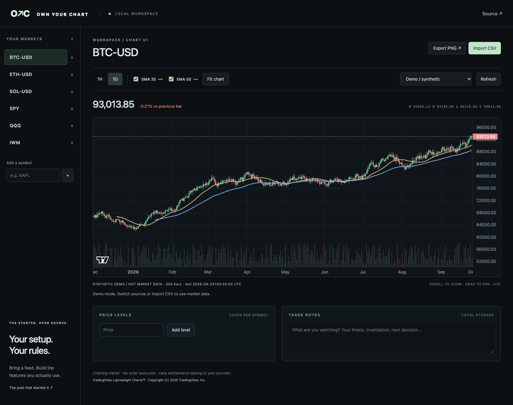

# Own Your Chart

**Your workspace. Your data feed. Your code.**

A local charting starter for traders who want to build the features they actually use. Inspired by [Chris Dover's post about building your own charting setup](https://x.com/ChrisDMacro/status/2105043046937104606).



## Run it

Install [Node.js](https://nodejs.org/) 22.12+ and Python 3.10+, then:

```bash
git clone https://github.com/ChrisDover/own-your-chart.git
cd own-your-chart
npm ci
npm run build
npm start
```

Open **http://127.0.0.1:8765**. Stop with Ctrl+C. No account or API key is needed for the clearly labeled synthetic demo or the public crypto adapter. Keep the terminal running. To update source files, rebuild and refresh the browser.

## What works

- Candlesticks, volume, zoom, pan, crosshair and PNG export.
- Switch between hourly and daily bars.
- SMA 20 and EMA 50 overlays, computed locally.
- Watchlist with your own symbols, horizontal price levels, and notes.
- Saved watchlist, selected market, indicators, levels and notes in browser localStorage.
- CSV import with validation. Imported candles stay in memory for this session.
- Coinbase public historical candles for BTC-USD, ETH-USD and SOL-USD.
- Alpha Vantage daily stock/ETF adapter using your own server-side API key.

This is a usable **starter**, not feature parity with TradingView. It has no Pine Script runtime/import, backtesting, broker connection, orders, streaming quotes, alerts, trendline tools, multi-chart layouts, or futures adapter. Settings are saved in this browser, not synced between devices. Export important notes yourself; clearing browser storage deletes them.

## Bring market data

| Source | Coverage in this starter | Setup |
|---|---|---|
| Synthetic demo | Six example symbols; generated, not market prices | Default; works offline after installation |
| Coinbase public | BTC-USD, ETH-USD, SOL-USD; 1H / 1D, up to provider's 300-candle response | Choose Coinbase, then a supported symbol |
| Alpha Vantage | Stock and ETF tickers; 1D unadjusted OHLCV | Set your own API key below |
| CSV | Any market with compatible OHLCV | Import CSV; original bar spacing is preserved |

Data is fetched on source/symbol/timeframe changes and manual refresh, with a 60-second server cache. There is no background polling. Provider availability, geography, limits and entitlements apply. The latest Coinbase candle can be incomplete. Daily stock bars are unadjusted: splits and dividends can affect interpretation. Dates are displayed at UTC midnight, not as exchange-session timestamps. Feed adapters never silently substitute demo data on failure.

Alpha Vantage setup (macOS/Linux):

```bash
export ALPHA_VANTAGE_API_KEY='your-own-key'
npm start
```

PowerShell:

```powershell
$env:ALPHA_VANTAGE_API_KEY = 'your-own-key'
npm start
```

The server reads the environment; it does **not** load `.env` files. Keys are never sent to the browser. No paid-provider subscription is purchased or included. Alpha Vantage quotas and plan access are governed by [its documentation](https://www.alphavantage.co/documentation/). Public Coinbase requests follow [the Exchange candles API](https://docs.cdp.coinbase.com/exchange/reference/exchangerestapi_getproductcandles).

CSV columns:

```csv
time,open,high,low,close,volume
2026-01-01,100,103,99,102,1000
2026-01-02,102,105,101,104,1200
```

Time accepts UTC dates, ISO timestamps with explicit timezone, or Unix **seconds**. Each timestamp must be unique. Prices must be finite and positive, highs/lows must contain opens/closes, and volume must be nonnegative. Rows are sorted before rendering. Limits: 10 MB, 100,000 candles. CSV import does not resample data; the original interval is shown regardless of the toolbar selection. Selecting a source, market, timeframe, or refresh replaces imported candles.

## Make it yours with AI

Read [the customization prompt](docs/CUSTOMIZE.md). Keep a working baseline, describe one feature, ask your coding assistant to change it, and verify it before adding the next.

| File | Purpose |
|---|---|
| `src/main.js` | Workspace, controls, saved state and chart wiring |
| `src/data.js` | CSV validation, moving averages and deterministic demo |
| `src/style.css` | Layout, colors and responsive styles |
| `server.py` | Local HTTP server and read-only provider adapters |
| `tests/` | Calculation, adapter, browser and boundary checks |

The chart renderer is TradingView's open-source Lightweight Charts™, not TradingView's hosted platform or Pine engine. A small Vite/JavaScript frontend and Python standard-library server keep the starter easy to inspect. No database, LLM API or subscription is required to run it.

## Verify

```bash
npm test
npx playwright install chromium
npm run test:e2e
```

The browser tests build the app and start an isolated server on port 8766. They cover market switching, indicators, notes/level persistence, CSV acceptance and rejection, provider failure, PNG download, foreign host/origin rejection and mobile overflow. Live feeds are deliberately separate from deterministic tests. See [verification notes](docs/VERIFICATION.md) for the release's actual checks and limitations.

## Local by design

The server binds to `127.0.0.1` and rejects foreign Host and Origin headers. It serves only the built `dist/` folder. API URLs are fixed in provider code. This is a personal workstation server: do not expose it to the public internet. Data-provider request failures are returned without upstream URLs or API keys.

## License and credits

Original starter code: MIT. Lightweight Charts™ is a separate Apache-2.0 dependency with its own copyright and notice obligations. See [THIRD_PARTY_NOTICES.md](THIRD_PARTY_NOTICES.md). The app includes visible TradingView attribution and the library attribution logo. No affiliation or endorsement is implied.

Contributions welcome: open an issue describing the workflow, data source, and a reproducible acceptance check before a large feature. A good first adapter is documented, read-only, validates OHLCV and reports provider failures explicitly.
