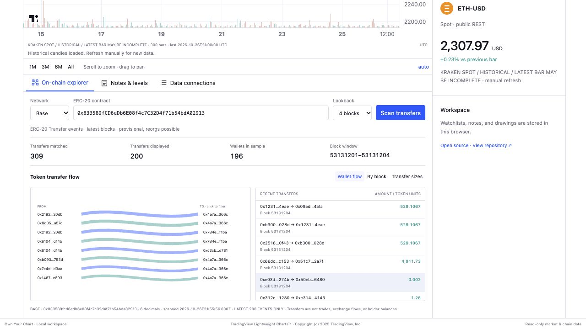

# Own Your Chart

**A familiar charting workspace. Your data providers. Your on-chain research.**

A local, open-source charting starter with a TradingView-style layout, pluggable market data, and Ethereum/Base ERC-20 transfer visualizations. Inspired by [Chris Dover’s original post](https://x.com/ChrisDMacro/status/2105043046937104606).




## Run locally

Install [Node.js](https://nodejs.org/) 22.12+ and Python 3.10+:

```bash
git clone https://github.com/ChrisDover/own-your-chart.git
cd own-your-chart
npm ci
npm run build
npm start
```

Open **http://127.0.0.1:8765**. Keep the terminal running; stop with Ctrl+C. After editing frontend code, rebuild and refresh. No account is required for the synthetic demo, public crypto adapters, or default RPC scans, subject to provider availability and limits.

## The workspace

- Compact top toolbar, left drawing tools, right watchlist and instrument details, bottom research tabs.
- Light and dark themes; candles or line chart, volume, SMA 20 and EMA 50.
- 1m / 5m / 15m / 1H / 4H / 1D intervals where the selected provider supports them.
- Two-click trend lines, horizontal price levels, ruler, range shortcuts and PNG export.
- Watchlists, notes, levels, drawings and display preferences saved in browser localStorage.
- CSV import with OHLCV/date validation. Imported bars stay in memory for the current session; their original interval is preserved.

This recreates the familiar workspace arrangement, not TradingView’s complete functionality. It has no Pine runtime/import, backtesting, streaming quotes, broker orders, alerts, arbitrary-token DEX candle discovery, or multi-chart layouts. It is independently developed and not affiliated with TradingView. The renderer is TradingView’s open-source **Lightweight Charts™**, with attribution preserved.

## Choose your feed

Use the chart’s source dropdown or **Data providers → Use feed**.

| Provider | Markets | Intervals | Key |
|---|---|---|---|
| Coinbase | BTC-USD, ETH-USD, SOL-USD spot | 1m, 5m, 15m, 1H, 1D | None |
| Kraken | BTC-USD, ETH-USD, SOL-USD spot | All six workspace intervals | None |
| Hyperliquid | BTC, ETH, SOL, HYPE perpetuals, shown with `-USD` aliases | All six workspace intervals | None |
| Alpha Vantage | Stock / ETF tickers | 1D unadjusted | Your own server-side key |
| Synthetic demo | Example markets and arbitrary tickers | All six intervals | None |
| Your connection | Any market returned by your normalized OHLCV endpoint | Configurable | Optional environment reference |

Candles are fetched on market/source/timeframe changes and manual refresh, with a 30-second server cache. Up to 300 bars are displayed. The latest crypto candle can be incomplete. Coinbase/Kraken are spot markets; Hyperliquid is perpetuals and may have different prices. The watchlist shows only prices loaded in this session for the selected feed/timeframe; `Δ bar %` compares the last candle to the previous candle, not a 24-hour change. Blank cells mean no loaded quote. No failed request silently substitutes synthetic data.

Provider limits, geographical restrictions and terms apply. Public does not mean guaranteed availability or unrestricted redistribution. See [Coinbase](https://docs.cdp.coinbase.com/api-reference/exchange-api/rest-api/products/get-product-candles), [Kraken](https://docs.kraken.com/api-reference/market-data/get-ohlc-data), and [Hyperliquid](https://hyperliquid.gitbook.io/hyperliquid-docs/for-developers/api/info-endpoint).

For Alpha Vantage:

```bash
export ALPHA_VANTAGE_API_KEY='your-own-key'
npm start
```

PowerShell uses `$env:ALPHA_VANTAGE_API_KEY = 'your-own-key'`. The server reads environment variables and does **not** load `.env` files. Daily stock candles are unadjusted and use UTC-midnight dates; corporate actions can affect interpretation.

## Connect your own provider

Open **Data connections → Connect a provider**. Enter a connection name, id beginning with `custom-`, an HTTPS URL template, optional ticker allowlist, and an optional key environment-variable name. Use `{symbol}` and `{timeframe}` placeholders.

Your endpoint must return this normalized contract (or a plain array of these candles):

```json
{
  "bars": [
    {"time": 1790000000, "open": 100, "high": 102, "low": 99, "close": 101, "volume": 500}
  ]
}
```

The server URL-encodes placeholders, validates candles and keeps credentials server-side. Configure `MY_FEED_KEY` in the server environment, then select its name in the connection form. The optional Bearer checkbox supports `Authorization: Bearer …`. Do not put secrets in URL paths or query strings. Redirects are rejected so credentials are not forwarded to another host.

Connections are saved to ignored **providers.local.json**, outside the served `dist/` directory. The UI supports adding/updating a connection by id. Remove a connection by editing that local file and refreshing. For a raw vendor API with a different schema, add a normalization adapter in `providers.py` or put a small adapter in front of it; an arbitrary vendor URL is not automatically schema-compatible.

## Explore Ethereum and Base

In **On-chain explorer**, choose Ethereum or Base, paste an ERC-20 token contract, select 4, 12 or 32 recent blocks, and click **Scan transfers**. The defaults are USDC contracts on each network.

Three views use real RPC `Transfer` events:

- **Wallet flow** — up to eight largest sender/recipient pairs in the displayed sample. Click an address to filter the ledger.
- **By block** — transfer counts per block in the displayed sample.
- **Transfer sizes** — distribution of token amounts in the displayed sample.

The ledger links to the corresponding block explorer transaction. The panel displays the contract, chain, block range, decimal precision, scan time, matched count and whether only the latest 200 events are shown. Zero-address mint/burn events remain in transfer visuals but are excluded from the wallet count.

These are bounded **token transfer scans**, not full-chain indexing, wallet balances, holder concentration, identified exchange flows, or buys/sells. The chart’s selected market and scanned contract are independent. A scan does not attach transfer activity to exchange candles or imply a trading signal. Recent blocks are provisional and may reorganize. See [the scanner’s data model and limits](docs/ONCHAIN.md).

Defaults use public Ethereum and Base RPCs. You can bring your own HTTPS endpoints:

```bash
export ETHEREUM_RPC_URL='https://your-ethereum-rpc.example'
export BASE_RPC_URL='https://your-base-rpc.example'
npm start
```

The server checks chain IDs and exposes no signing or transaction-submission methods. Public endpoints can fail or throttle; set your own endpoint when reliability matters. Scans are manual, cached for 30 seconds, and never fall back to invented events.

## CSV format

```csv
time,open,high,low,close,volume
2026-01-01,100,103,99,102,1000
2026-01-02,102,105,101,104,1200
```

Use plain unquoted fields. Time accepts UTC dates, ISO timestamps with an explicit timezone, or Unix **seconds**. Dates must exist, times must be unique, prices must be finite/positive, highs/lows must contain opens/closes, and volume must be nonnegative. Rows are sorted. Limits: 10 MB / 100,000 candles. CSV import does not resample. Changing market/source/timeframe or refreshing replaces imported data. CSV is available in the Data connections tab.

## Verify and customize

```bash
npm test
npx playwright install chromium
npm run test:e2e
```

Browser checks start an isolated server on port 8766. See [verification notes](docs/VERIFICATION.md) for actual live checks and fixture coverage. There is no LLM in the running application; AI coding assistants can modify it using [this customization prompt](docs/CUSTOMIZE.md).

| File | Purpose |
|---|---|
| `src/layout.js`, `src/style.css` | Workspace structure and appearance |
| `src/main.js` | Chart, interactions, saved state and connections |
| `src/chain.js` | Transfer visualizations and ledger |
| `src/data.js` | CSV validation, indicators and deterministic demo |
| `providers.py` | Market-data adapters and custom connections |
| `onchain.py` | Bounded, read-only ERC-20 RPC scanner |
| `server.py` | Loopback-only HTTP server |

Browser storage is not a backup. Clearing it deletes saved workspace settings. Notes and levels are scoped by provider/market; trend lines also by timeframe. Existing v0.1 symbol-only notes/levels are retained and copied into the selected provider namespace during migration.

## Local by design

The server binds to `127.0.0.1`, validates Host/Origin, serves only built assets, and requires same-origin JSON for connection changes. Personal feed/RPC credentials and local connections remain outside served assets and Git. This is a personal workstation server; keep it on loopback.

Original code: MIT. Dependencies retain their own licenses. See [third-party notices](THIRD_PARTY_NOTICES.md). Contributions welcome: describe a workflow and a reproducible acceptance check before adding a large feature.
